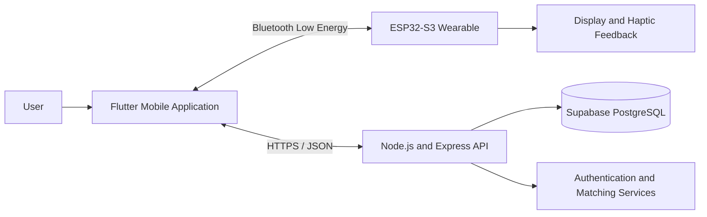

<div align="center">

# VEXA

### A BLE-Enabled Wearable Platform for Real-World Social Discovery

**Graduation Project · Bahçeşehir University · 2025–2026**


</div>

---

## About VEXA

**VEXA** is a multidisciplinary graduation project that combines a mobile application, a cloud-based backend and a BLE-enabled wearable device to support real-world social discovery and professional networking.

The project explores a simple question:

> How can technology make it easier for people with compatible interests to discover and approach each other in physical environments?

Instead of requiring users to continuously browse profiles, VEXA uses Bluetooth Low Energy proximity detection, mutual interaction and a short live quiz to create a more natural connection experience.

When two compatible users are nearby, their wearable devices notify them through vibration. After both users complete the matching flow, the device can display a directional indicator that helps them locate each other.

---

## Project Goals

VEXA was designed to:

* Reduce the difficulty of initiating conversations in real-world environments.
* Connect people based on shared interests and mutual participation.
* Support both social interaction and professional networking.
* Provide a privacy-aware alternative to precise GPS-based discovery.
* Explore the integration of mobile, backend and embedded systems in one product.

---

## How It Works

1. The user creates a profile and selects an avatar.
2. The user pairs the VEXA wearable with the mobile application.
3. The user selects an interaction mode.
4. Nearby VEXA devices are discovered using Bluetooth Low Energy.
5. Both users receive a matching invitation.
6. The users answer a five-question live quiz.
7. A match is successful when at least four out of five answers are compatible.
8. The wearable vibrates and displays a directional indicator.
9. The completed interaction is stored in the user's match history.

### Match Threshold

```text
4 compatible answers out of 5 questions = 80% agreement
```

The matching process requires mutual participation. A user is not automatically revealed to another user without entering the matching flow.

---

## Interaction Modes

| Mode              | Purpose                                                 |
| ----------------- | ------------------------------------------------------- |
| **Social Mode**   | Discover people for friendship and social interaction.  |
| **Business Mode** | Connect with people for professional networking.        |
| **Ghost Mode**    | Temporarily stop appearing in nearby discovery results. |

Each mode has its own visual identity within the mobile application and wearable interface.

---

## Main Features

### Mobile Application

* User registration and authentication
* Google Sign-In integration
* Profile creation and editing
* Custom avatar selection
* Social, Business and Ghost modes
* Interest and discovery preferences
* BLE device scanning and pairing
* Nearby-user discovery
* Live matching invitations
* Five-question quiz interface
* Match result calculation
* Match history
* Device management and settings
* RSSI-based directional guidance prototype

### Wearable Device

* ESP32-S3-based embedded system
* Bluetooth Low Energy communication
* Compact color display
* Avatar and status display
* Haptic vibration feedback
* Match notifications
* Quiz-time notification
* Directional arrow interface
* Rechargeable battery integration
* Portable keychain enclosure concept

### Backend System

* RESTful API architecture
* JWT-based authentication
* Secure password hashing
* User and profile management
* Avatar management
* Mode and availability settings
* Device pairing records
* Candidate and compatibility operations
* Match result storage
* Match history
* PostgreSQL persistence
* Production deployment on Render

---

## System Architecture



### Communication Flow

```text
Wearable Device
      ⇅ BLE
Flutter Mobile Application
      ⇅ REST API
Node.js / Express Backend
      ⇅ SQL
Supabase PostgreSQL
```

The mobile application acts as the bridge between the physical wearable and the cloud backend.

---

## Technology Stack

| Layer                    | Technologies                  |
| ------------------------ | ----------------------------- |
| **Mobile Application**   | Flutter, Dart                 |
| **Backend**              | Node.js, Express.js           |
| **Database**             | Supabase PostgreSQL           |
| **Authentication**       | JWT, bcryptjs, Google OAuth   |
| **Database Connection**  | node-postgres (`pg`)          |
| **Device Communication** | Bluetooth Low Energy          |
| **Embedded Hardware**    | ESP32-S3, LILYGO T-Display S3 |
| **Device Interface**     | TFT display, haptic vibration |
| **Avatar System**        | DiceBear                      |
| **Backend Deployment**   | Render                        |
| **Version Control**      | Git, GitHub                   |

---

## Matching Approach

VEXA's matching logic evolved during the development process.

### Initial Backend Prototype

The first backend version calculated a compatibility score using:

* Common interests
* Common personality tags
* Selected interaction mode

This approach was used to test candidate discovery, database operations and match-history functionality.

### Final MVP Approach

The final product concept uses a live five-question quiz.

```text
Match successful: 4 or 5 compatible answers
Match unsuccessful: 0 to 3 compatible answers
```

This approach makes the match more interactive and ensures that both users actively participate in the process.

---

## Repository Scope

This repository primarily contains the backend implementation and the technical integration documentation developed for VEXA.

The complete graduation project also includes:

* Flutter mobile application
* BLE communication layer
* ESP32-S3 wearable prototype
* Device firmware experiments
* Physical product and enclosure design
* Business model and feasibility analysis

The repository structure is organized as follows:

```text
vexa-project/
│
├── backend/          # Node.js and Express REST API
├── frontend/         # Mobile application workspace and integration area
├── docs/             # API, database and integration documentation
└── README.md
```

---

## Backend API

### Base URLs

Local development:

```text
http://localhost:3000/api
```

Project deployment:

```text
https://vexa-backend-umg2.onrender.com/api
```

The deployment may require a short startup period when hosted on a free-tier service.

### Main Endpoint Groups

| Method   | Endpoint               | Description                       |
| -------- | ---------------------- | --------------------------------- |
| `GET`    | `/health`              | Check backend availability        |
| `POST`   | `/auth/register`       | Register a new user               |
| `POST`   | `/auth/login`          | Authenticate a user               |
| `GET`    | `/users/me`            | Retrieve the current user         |
| `PUT`    | `/users/me/profile`    | Create or update a profile        |
| `PUT`    | `/users/me/avatar`     | Update the selected avatar        |
| `PUT`    | `/users/me/mode`       | Update the interaction mode       |
| `GET`    | `/avatars`             | Retrieve available avatars        |
| `GET`    | `/devices/mock-nearby` | Retrieve simulated nearby devices |
| `POST`   | `/devices/pair`        | Pair a wearable device            |
| `GET`    | `/devices/my-device`   | Retrieve the paired device        |
| `DELETE` | `/devices/unpair`      | Remove a device pairing           |
| `GET`    | `/matches/candidates`  | Retrieve potential candidates     |
| `POST`   | `/matches/check`       | Calculate and store compatibility |
| `GET`    | `/matches/history`     | Retrieve previous match results   |

Detailed request and response examples are available in the `docs/` directory.

---

## Backend Installation

### Prerequisites

Make sure the following are installed:

* Node.js
* npm
* PostgreSQL-compatible database
* Git

### 1. Clone the Repository

```bash
git clone https://github.com/ylmzcanckm/vexa-project.git
cd vexa-project/backend
```

### 2. Install Dependencies

```bash
npm install
```

### 3. Configure Environment Variables

Copy the example environment file:

```bash
cp .env.example .env
```

Add the required values:

```env
PORT=3000
JWT_SECRET=your_secure_jwt_secret
DATABASE_URL=your_postgresql_connection_string
```

Never commit real credentials or environment files to the repository.

### 4. Start the Development Server

```bash
npm run dev
```

For a production-style start:

```bash
npm start
```

### 5. Test the Backend

```http
GET http://localhost:3000/api/health
```

Expected response:

```json
{
  "success": true,
  "message": "VEXA backend is running"
}
```

---

## Database Modules

The PostgreSQL database stores information related to:

* Users
* Profiles
* User settings
* Avatars
* Paired devices
* Matches
* Match history

UUID values are used as entity identifiers. Client applications should always use IDs returned by the API instead of hardcoded values.

---

## Security and Privacy Considerations

The prototype includes several security and privacy-oriented decisions:

* Passwords are hashed before database storage.
* Protected endpoints require JWT authentication.
* Environment variables are excluded from version control.
* Users can disable discovery through Ghost Mode.
* Matching requires interaction from both participants.
* BLE proximity is used instead of exposing precise GPS coordinates.
* Sensitive database credentials are not stored in the source code.

VEXA is an academic MVP and would require additional security testing, rate limiting, validation and privacy reviews before production use.

---

## Project Status

**Status: Functional academic MVP**

The project successfully demonstrated:

* Mobile and backend communication
* User authentication and profile operations
* Persistent PostgreSQL storage
* Device pairing flow
* BLE communication experiments
* Wearable screen and vibration feedback
* Matching and quiz interfaces
* Match-history operations
* End-to-end product scenario

The system was developed as a proof of concept and is not currently intended for commercial production use.

---

## My Contribution

My primary responsibilities in the project included:

* Designing and developing the Node.js and Express backend
* Creating REST API endpoints
* Implementing authentication and authorization
* Integrating Supabase PostgreSQL
* Designing database-backed user, device and match operations
* Deploying the backend through Render
* Preparing API and frontend integration documentation
* Supporting ESP32-S3 firmware and BLE integration experiments
* Testing communication between the mobile application, backend and wearable device

---

## Graduation Project Team

**Bahçeşehir University**

* **Tuana Çepikkurt** — Management Engineering
* **Kadir Karakuş** — Management Engineering
* **Yılmaz Can Çakmak** — Software Engineering
* **Selçuk Büyükpoyraz** — Software Engineering

**Academic Advisor:** Ayla Gülcü

---

## What We Learned

VEXA provided hands-on experience in:

* Full-stack system design
* REST API development
* Relational database modelling
* Mobile and embedded-system integration
* Bluetooth Low Energy communication
* Authentication and session management
* Cloud deployment
* Hardware and software prototyping
* Interdisciplinary teamwork
* MVP planning and product validation

---

## Future Improvements

Potential future developments include:

* Improved BLE distance and direction estimation
* Real-time WebSocket-based matching sessions
* Push notifications
* Expanded quiz catalog
* End-to-end encrypted device communication
* Advanced discovery filters
* Automated testing and CI/CD
* Rate limiting and API monitoring
* Improved device enclosure and battery life
* Android and iOS production releases
* Large-scale user and usability testing

---

<div align="center">

### VEXA

**Turning proximity into meaningful connections.**

Developed as a graduation project at Bahçeşehir University.

</div>
