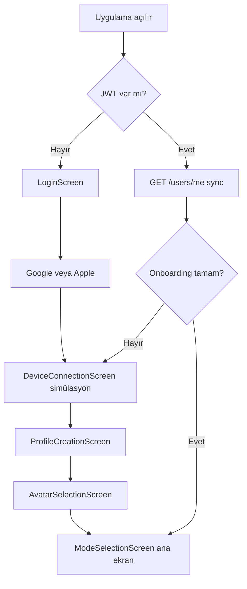

# VEXA — Backend geliştirici rehberi (ekranlar + test)

**Kime:** Backend / API sorumlusu (Selçuk ~1 hafta şehir dışında)  
**Repo:** `https://github.com/ylmzcanckm/vexa-project`  
**Branch:** `dev`  
**Son güncelleme:** Mayıs 2026  

Bu doküman: tüm Flutter ekranları, navigasyon, hangi verinin nerede saklandığı, hangi API’nin bağlı olduğu ve **adım adım nasıl test edileceği**.

---

## İçindekiler

1. [Proje yapısı](#1-proje-yapısı)  
2. [Ürün akışı (kullanıcı yolculuğu)](#2-ürün-akışı-kullanıcı-yolculuğu)  
3. [Ekranlar — detaylı liste](#3-ekranlar--detaylı-liste)  
4. [Frontend ↔ Backend entegrasyon durumu](#4-frontend--backend-entegrasyon-durumu)  
5. [Profil verisi: geçici `bio` köprüsü](#5-profil-verisi-geçici-bio-köprüsü)  
6. [Backend API özeti](#6-backend-api-özeti)  
7. [Ortam kurulumu](#7-ortam-kurulumu)  
8. [Test rehberi — API (curl / Postman)](#8-test-rehberi--api-curlpostman)  
9. [Test rehberi — Flutter uygulaması](#9-test-rehberi--flutter-uygulaması)  
10. [Google / Apple OAuth](#10-google--apple-oauth)  
11. [Selçuk yokken öncelikli işler](#11-selçuk-yokken-öncelikli-işler)  
12. [Bilinen sorunlar](#12-bilinen-sorunlar)  
13. [Selçuk dönünce](#13-selçuk-dönünce)  

---

## 1. Proje yapısı

```text
vexa-project/
├── backend/          # Node.js + Express + Supabase PostgreSQL
├── frontend/         # Flutter (Dart) — mobil + web
├── docs/
│   ├── api_contract.md              # Resmi API sözleşmesi
│   ├── frontend_integration_guide.md
│   ├── BACKEND_OAUTH_GOREV_LISTESI.md
│   └── ARKADAS_BACKEND_VE_TEST_REHBERI.md  # Bu dosya
└── README.md
```

| URL | Açıklama |
|-----|----------|
| `https://vexa-backend-umg2.onrender.com/api` | Production API |
| `http://localhost:3000/api` | Local backend |

Flutter production API’ye bağlı (`lib/core/config/app_config.dart`).

---

## 2. Ürün akışı (kullanıcı yolculuğu)



**Onboarding tamamlanma koşulu (local):**

- `OnboardingPreferences.isComplete == true`  
  veya otomatik: isim + soyisim + doğum tarihi + avatar seed dolu → mod ekranı

**Cihaz:** Zorunlu adım (simülasyon). Gerçek BLE yok.

---

## 3. Ekranlar — detaylı liste

### 3.0 `AppStartupScreen`

| | |
|--|--|
| **Dosya** | `frontend/lib/app/app_startup_screen.dart` |
| **Ne yapar** | JWT kontrolü; varsa `UserRepository.syncFromServer()`; sonra `AppRouter` ile doğru ekrana yönlendirir |
| **API** | `GET /users/me` (token ile) |
| **Hata UI** | Sunucu yoksa “Tekrar dene” / “Giriş ekranına dön” |

---

### 3.1 `LoginScreen` — Giriş

| | |
|--|--|
| **Dosya** | `frontend/lib/features/auth/presentation/screens/login_screen.dart` |
| **UI** | VEXA logosu, “Hoş Geldiniz”, **Google ile Devam Et**, **Apple ile Devam Et** |
| **E-posta/şifre** | Yok (bilinçli) |
| **API** | `POST /auth/google` (`idToken` veya `accessToken`) · `POST /auth/apple` |
| **Sonraki ekran** | `DeviceConnectionScreen` |

---

### 3.2 `DeviceConnectionScreen` — Cihaz eşlemesi (simülasyon)

| | |
|--|--|
| **Dosya** | `frontend/lib/features/device/presentation/screens/device_connection_screen.dart` |
| **UI** | LilyGO / VEXA cihaz tanıtımı, “Cihazı bağla (simülasyon)” |
| **API** | **Bağlı değil** — sadece `DeviceConnectionPreferences.setLinked(true)` |
| **Backend hazır** | `POST /devices/pair`, `GET /devices/my-device`, `GET /devices/mock-nearby` |
| **Geri** | Login’e dönebilir |

**İleride:** Gerçek BLE + `pair` endpoint.

---

### 3.3 `ProfileCreationScreen` — Temel profil (onboarding)

| | |
|--|--|
| **Dosya** | `frontend/lib/features/profile/presentation/screens/profile_creation_screen.dart` |
| **Alanlar** | İsim, soyisim, doğum tarihi (gün/ay/yıl) → yaş hesaplanır |
| **API** | `PUT /users/me/profile` (`ProfileBioCodec` ile `bio` içinde JSON) |
| **Yerel** | `UserProfileStore` (SharedPreferences) |
| **Sonraki** | `AvatarSelectionScreen` |

**Not:** Boy/kilo/eğitim/ilgi alanları burada **yok** — mod ekranında sosyal/network kapısında doldurulur.

---

### 3.4 `AvatarSelectionScreen` — Avatar (DiceBear Dylan)

| | |
|--|--|
| **Dosya** | `frontend/lib/features/onboarding/presentation/screens/avatar_selection_screen.dart` |
| **UI** | Manuel avatar: saç, ten, sakal, mood vb. (DiceBear HTTP API önizleme) |
| **API** | `PUT /users/me/profile` (güncel profil) + `PUT /users/me/avatar` (ilk backend avatar UUID) |
| **DiceBear** | Harici: `api.dicebear.com` — tasarım CC BY 4.0 |
| **Sonraki** | `ModeSelectionScreen` + `OnboardingPreferences.setComplete(true)` |

`standaloneEdit: true` ile profilden sadece avatar düzenleme modu da var.

---

### 3.5 `ModeSelectionScreen` — Ana ekran

| | |
|--|--|
| **Dosya** | `frontend/lib/features/mode/presentation/screens/mode_selection_screen.dart` |
| **Üst** | VEXA + pill bar: **Social** · **Ghost** · **Business** |
| **Orta** | `PageView` — moda göre gradient arka plan, kaydırarak mod değişimi |
| **Alt bar** | **Geçmiş** · **Profil** · **Ayarlar** |

#### Modlar (`VexaMode`)

| Mod | Renk / içerik | Profil kapısı |
|-----|----------------|---------------|
| **social** | Mor/lavanta gradient | Sosyal profil tamamlanmamışsa blur + popup → `SocialProfileCompletionSection` |
| **ghost** | Gri, büyük hayalet emoji | İşlev yok (placeholder) |
| **business** | Mavi gradient | Network profil kapısı → `BusinessProfileCompletionSection` |

**Social mod gövde (profil tamamsa):** sadece `DiscoveryFiltersSection` (yaş, boy, kilo, eğitim, cinsiyet, sigara/alkol filtreleri).

**API mod:** `PUT /users/me/mode` — frontend’de **henüz otomatik çağrılmıyor** (sadece local state).

---

### 3.6 `HistoryScreen` — Geçmiş

| | |
|--|--|
| **Dosya** | `frontend/lib/features/history/presentation/history_screen.dart` |
| **UI** | “Yakında” placeholder |
| **API hazır** | `GET /matches/history` |

---

### 3.7 `ProfilePersonScreen` — Profil kartı

| | |
|--|--|
| **Dosya** | `frontend/lib/features/profile/presentation/screens/profile_person_screen.dart` |
| **UI** | Avatar, isim, soyisim, boy/kilo, hobiler, hakkımda placeholder |
| **Düzenle** | `ProfileEditScreen`’e gider (Ghost / Social / Network sekmeleri) |

---

### 3.8 `ProfileEditScreen` — Profil düzenleme

| | |
|--|--|
| **Dosya** | `frontend/lib/features/profile/presentation/screens/profile_edit_screen.dart` |
| **Sekmeler** | Çekirdek (isim, soyisim, yaş) · Sosyal · Network (moda göre) |
| **API** | Sosyal/network kayıtta `UserRepository.syncLocalProfileToServer()` |

---

### 3.9 Sosyal profil formu (widget, tam ekran değil)

| | |
|--|--|
| **Dosya** | `frontend/lib/features/mode/presentation/widgets/social_profile_completion_section.dart` |
| **Alanlar** | Boy, kilo, cinsiyet, eğitim (tab), sigara, alkol, ilgi alanları (1–3, emoji’li), hakkımda, random skill |
| **API** | `PUT /users/me/profile` (bio codec) |

---

### 3.10 Network / Business profil formu (widget)

| | |
|--|--|
| **Dosya** | `frontend/lib/features/mode/presentation/widgets/business_profile_completion_section.dart` |
| **Alanlar** | İş unvanı, şirket/üniversite, bölüm, şehir, çalışma durumu, professional tags (tab), looking for, elevator pitch, LinkedIn, iş e-postası, **fotoğraf yükleme** (yerel dosya) |
| **API** | `PUT /users/me/profile` |
| **Not** | `hardSkills` kaldırıldı; avatar bu ekranda yok |

---

### 3.11 `SettingsScreen` — Ayarlar menüsü

| | |
|--|--|
| **Dosya** | `frontend/lib/features/settings/presentation/settings_screen.dart` |

| Menü | Alt ekran | Backend |
|------|-----------|---------|
| Cihaz | `BleDeviceSettingsScreen` | İskelet |
| Bildirimler | Placeholder | Yok |
| Gizlilik | Placeholder | Yok |
| Erişilebilirlik | Placeholder | Yok |
| Hesap | `AccountSettingsScreen` | Çıkış = token sil |
| VEXA hakkında | `AboutVexaScreen` | Sabit metin |
| Device Finder | Placeholder | Yok |
| Engelle / gizle | Placeholder | Yok |
| Veri izinleri | Placeholder | Yok |

---

### 3.12 `AccountSettingsScreen` — Hesap

| | |
|--|--|
| **Dosya** | `frontend/lib/features/settings/presentation/screens/account_settings_screen.dart` |
| **Özellikler** | Karanlık mod (çalışır), KVKK placeholder, hesap sil placeholder, **Çıkış yap** (JWT + onboarding + cihaz flag temizler → Login) |

---

### 3.13 `BleDeviceSettingsScreen` — BLE iskelet

| | |
|--|--|
| **Dosya** | `frontend/lib/features/settings/presentation/screens/ble_device_settings_screen.dart` |
| **UI** | Pil, bağlantı, titreşim, parlaklık vb. — çoğu etkileşimsiz |
| **Ses ayarları** | Kaldırıldı (ses çipi yok) |

---

## 4. Frontend ↔ Backend entegrasyon durumu

| Özellik | Frontend | Backend endpoint | Durum |
|---------|----------|------------------|--------|
| Google giriş | ✅ | `POST /auth/google` | Web: `accessToken` yaygın |
| Apple giriş | ✅ (UI) | `POST /auth/apple` | Console + deploy gerekir |
| Oturum / JWT | ✅ `flutter_secure_storage` | — | |
| Profil okuma | ✅ açılışta | `GET /users/me` | |
| Profil yazma | ✅ | `PUT /users/me/profile` | Bio JSON köprüsü |
| Avatar DB | ✅ ilk avatar UUID | `PUT /users/me/avatar` | |
| Mod kaydetme | ❌ UI only | `PUT /users/me/mode` | Bağlanacak |
| Cihaz eşleme | ❌ simülasyon | `POST /devices/pair` | Bağlanacak |
| Eşleşme adayları | ❌ | `GET /matches/candidates` | |
| Match check / quiz | ❌ | `POST /matches/check` | |
| Geçmiş | ❌ placeholder | `GET /matches/history` | |
| Discovery filtreleri | ❌ sadece Riverpod local | — | |

---

## 5. Profil verisi: geçici `bio` köprüsü

Backend `profiles` tablosu şu an: `bio`, `interests`, `personalityTags`.

Flutter’daki **geniş profil** (sosyal + network + doğum tarihi + avatar seed) tek seferde `bio` alanına gömülüyor:

```text
VEXA_PROFILE_V1:{...json...}
```

**Kod:** `frontend/lib/core/api/profile_bio_codec.dart`

**Senin için anlamı:**

- `GET /users/me` → `profile.bio` içinden tam profil parse edilebilir  
- `PUT /users/me/profile` → aynı formatı kabul et  
- Uzun vadede: ayrı kolonlar / tablolar (sosyal_profile, business_profile) önerilir  

**`interests`:** Sosyal moddaki `interestIds` listesi (ör. `sport`, `tech`).  
**`personalityTags`:** Örn. `gender:Kadın`, `education:Lisans`.

---

## 6. Backend API özeti

Detay için: `docs/api_contract.md`.

### Auth

| Method | Path | Auth | Body özeti |
|--------|------|------|------------|
| POST | `/auth/register` | Hayır | email, password, fullName |
| POST | `/auth/login` | Hayır | email, password |
| POST | `/auth/google` | Hayır | `idToken` **veya** `accessToken` |
| POST | `/auth/apple` | Hayır | `identityToken`, `email?`, `fullName?` |

### Users (JWT gerekir)

| Method | Path | Açıklama |
|--------|------|----------|
| GET | `/users/me` | Kullanıcı + profile + settings |
| PUT | `/users/me/profile` | bio, interests, personalityTags |
| PUT | `/users/me/avatar` | `avatarId` (UUID, `GET /avatars` listesinden) |
| PUT | `/users/me/mode` | `social` veya `networking` |

### Avatars

| Method | Path |
|--------|------|
| GET | `/avatars` |

### Devices

| Method | Path |
|--------|------|
| GET | `/devices/mock-nearby` |
| POST | `/devices/pair` |
| GET | `/devices/my-device` |
| DELETE | `/devices/unpair` |

### Matches

| Method | Path |
|--------|------|
| GET | `/matches/candidates` |
| POST | `/matches/check` |
| GET | `/matches/history` |

### Health

| Method | Path |
|--------|------|
| GET | `/health` |
| GET | `/db/health` |

---

## 7. Ortam kurulumu

### 7.1 Repo

```bash
git clone https://github.com/ylmzcanckm/vexa-project.git
cd vexa-project
git checkout dev
git pull origin dev
```

### 7.2 Backend local

```bash
cd backend
npm install
```

`backend/.env` (örnek — `.env.example`’dan):

```env
JWT_SECRET=...
DATABASE_URL=postgresql://...
GOOGLE_CLIENT_ID=74651460819-eolahk2dks1r9odgo5mjehpafgmetbeq.apps.googleusercontent.com
APPLE_CLIENT_ID=...   # Apple aşamasında
```

```bash
npm run dev
# → http://localhost:3000/api
```

### 7.3 Production (Render)

- Servis deploy: `dev` push sonrası veya manual  
- Env: `JWT_SECRET`, `DATABASE_URL`, `GOOGLE_CLIENT_ID`  
- İlk istek uykudan uyanma: 10–30 sn gecikme normal (free tier)  

---

## 8. Test rehberi — API (curl / Postman)

### 8.1 Health

```bash
curl https://vexa-backend-umg2.onrender.com/api/health
```

Beklenen: `"success": true`

### 8.2 Google route (sahte token)

```bash
curl -X POST https://vexa-backend-umg2.onrender.com/api/auth/google \
  -H "Content-Type: application/json" \
  -d '{"accessToken":"test"}'
```

Beklenen: **401** `Google sign-in failed` — route var demek (404 `Cannot POST` olmamalı).

### 8.3 E-posta ile test kullanıcı (geliştirme)

```bash
curl -X POST https://vexa-backend-umg2.onrender.com/api/auth/register \
  -H "Content-Type: application/json" \
  -d '{"email":"test@vexa.dev","password": "<DEMO_PASSWORD>","fullName":"Test User"}'

curl -X POST https://vexa-backend-umg2.onrender.com/api/auth/login \
  -H "Content-Type: application/json" \
  -d '{"email":"test@vexa.dev","password": "<DEMO_PASSWORD>"}'
```

Yanıttaki `token`’ı kopyala.

### 8.4 Profil (JWT ile)

```bash
export TOKEN="eyJhbGciOiJIUzI1NiIsInR5cCI6IkpXVCJ9..."

curl https://vexa-backend-umg2.onrender.com/api/users/me \
  -H "Authorization: Bearer $TOKEN"

curl -X PUT https://vexa-backend-umg2.onrender.com/api/users/me/profile \
  -H "Authorization: Bearer $TOKEN" \
  -H "Content-Type: application/json" \
  -d '{"bio":"test bio","interests":["tech"],"personalityTags":["calm"]}'
```

### 8.5 Avatar listesi

```bash
curl https://vexa-backend-umg2.onrender.com/api/avatars
```

UUID al → `PUT /users/me/avatar` ile `{ "avatarId": "..." }`

### 8.6 Mock cihazlar

```bash
curl https://vexa-backend-umg2.onrender.com/api/devices/mock-nearby \
  -H "Authorization: Bearer $TOKEN"
```

### 8.7 Eşleşme

```bash
curl https://vexa-backend-umg2.onrender.com/api/matches/candidates \
  -H "Authorization: Bearer $TOKEN"
```

---

## 9. Test rehberi — Flutter uygulaması

### 9.1 Kurulum

```bash
cd frontend
flutter pub get
flutter doctor
```

### 9.2 Web (Chrome) — Selçuk’un kullandığı yol

**Sabit port şart** (Google OAuth origins için):

```bash
flutter run -d chrome --web-port=7357
```

**Port meşgul hatası** (`Address already in use`):

```bash
# Portu kim kullanıyor
lsof -i :7357

# Eski dart/flutter sürecini kapat veya terminalde q
kill <PID>

# Tekrar
flutter run -d chrome --web-port=7357
```

Tarayıcı: `http://localhost:7357`

### 9.3 Tam uçtan uca test senaryosu (checklist)

| # | Adım | Beklenen |
|---|------|----------|
| 1 | Uygulama açılır | Login veya (token varsa) ana ekran |
| 2 | Google ile Devam Et | Google popup, hesap seçimi |
| 3 | İzin ver | Device ekranı |
| 4 | Cihazı bağla (simülasyon) | Profil oluştur |
| 5 | İsim, soyisim, doğum tarihi → Devam | Avatar ekranı |
| 6 | Avatar kaydet → Devam | Mod ekranı (Social) |
| 7 | Social’da profil popup → formu doldur | Filtreler görünür |
| 8 | Profil sekmesi (alt bar) | Kişi kartı |
| 9 | Ayarlar → Hesap → Karanlık mod | Tema değişir |
| 10 | Çıkış yap | Login ekranı |
| 11 | Uygulamayı kapat/aç | Token varsa `GET /users/me` → mod ekranı |

**Her adımda backend log / Supabase kontrol:** `users`, `profiles`, `user_settings` tabloları.

### 9.4 iOS / Android (ileride)

```bash
flutter run -d ios
# veya
flutter run -d android
```

Google için **iOS/Android OAuth client ID** gerekir (Web client ID yetmez). `serverClientId` web’de **kullanılmamalı** (assertion hatası).

### 9.5 Frontend’i local backend’e bağlama

`frontend/lib/core/config/app_config.dart`:

```dart
static const String apiBaseUrl = 'http://localhost:3000/api';
```

Chrome’dan local API için CORS backend’de açık (`cors()`).

---

## 10. Google / Apple OAuth

### 10.1 Google (aktif test)

| Ayar | Değer |
|------|--------|
| Render `GOOGLE_CLIENT_ID` | `74651460819-eolahk2dks1r9odgo5mjehpafgmetbeq.apps.googleusercontent.com` |
| Flutter `AppConfig.googleWebClientId` | Aynı (Web client) |
| Authorized JavaScript origins | `http://localhost:7357`, `http://127.0.0.1:7357` |
| People API | **Enable** (403 alınırsa) |

**Web notu:** Flutter Web çoğu zaman `idToken` vermez → frontend `accessToken` gönderir → backend `getTokenInfo` ile doğrular.

### 10.2 Apple (2. aşama)

- Apple Developer Services ID → `APPLE_CLIENT_ID`  
- `POST /auth/apple` deploy  
- iOS: Sign in with Apple capability  

---

## 11. Selçuk yokken öncelikli işler

Önerilen sıra:

### P0 — Stabil auth + profil

1. Google giriş production’da stabil (origins + People API)  
2. `GET /users/me` / `PUT /users/me/profile` — `VEXA_PROFILE_V1` bio parse doğrula  
3. Supabase’de test kullanıcıları ile regression  

### P1 — Eksik bağlantılar (frontend’e dokunmadan API hazırla)

4. `PUT /users/me/mode` — Flutter ileride `social` / `networking` map (business → networking)  
5. `POST /devices/pair` — simülasyon ekranından `deviceId` gönderimi için sözleşme netleştir  
6. `GET /matches/history` — Geçmiş ekranı için örnek payload  

### P2 — Mimari (1 hafta içinde konuşulacak)

7. Profili `bio` JSON yerine normalize tablolar  
8. Apple Sign In  
9. Match + quiz akışı (ürün: filtre → 15m → quiz %80)  

### P0 değil (cihaz yok)

- Gerçek BLE  
- LilyGO firmware  

---

## 12. Bilinen sorunlar

| Sorun | Çözüm |
|-------|--------|
| `origin_mismatch` | Google Console’a `http://localhost:7357` ekle |
| People API 403 | Console’da People API Enable |
| `Google kimlik jetonu alınamadı` | `accessToken` deploy + hot restart |
| `serverClientId is not supported on Web` | Web’de `serverClientId` kullanma (kodda düzeltildi) |
| Port 7357 meşgul | Eski `flutter run` kapat |
| Render ilk istek yavaş | Bekle, tekrar dene |
| `PUT /users/me/mode` business vs networking | Backend: `networking`, UI: `business` — map gerekir |

---

## 13. Selçuk dönünce

1. `git pull origin dev` (ikisi de)  
2. Bu dokümandaki checklist’i birlikte gözden geçir  
3. Frontend: mod API, device pair, matches/history bağlantıları  
4. İsterseniz `bio` köprüsünü kaldırıp şema migration  

---

## Hızlı iletişim şablonu (Selçuk’a)

Deploy / test sonrası:

```text
Deploy tamam.
- /auth/google accessToken/idToken OK
- /users/me OK
- Test kullanıcı: test@vexa.dev
- Blocker: ...
```

---

## İlgili dosyalar (kod referansı)

| Konu | Dosya |
|------|--------|
| API client | `frontend/lib/core/api/api_client.dart` |
| Auth | `frontend/lib/features/auth/data/auth_repository.dart` |
| User sync | `frontend/lib/features/auth/data/user_repository.dart` |
| OAuth | `frontend/lib/features/auth/data/oauth_sign_in_service.dart` |
| Router | `frontend/lib/core/navigation/app_router.dart` |
| Auth routes | `backend/src/routes/auth.routes.js` |
| User routes | `backend/src/routes/user.routes.js` |
| Match routes | `backend/src/routes/match.routes.js` |
| Device routes | `backend/src/routes/device.routes.js` |

---

*Sorular için: `docs/api_contract.md` veya repo issue / PR.*
